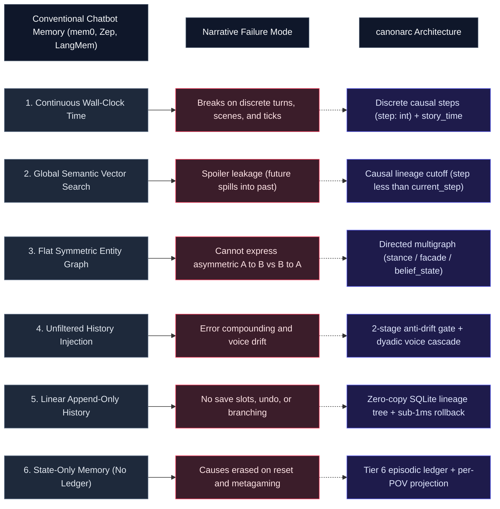
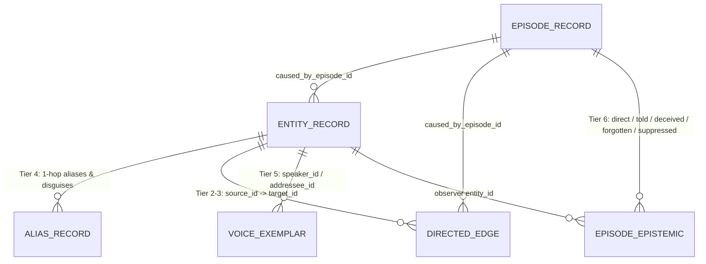
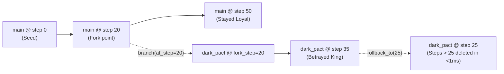
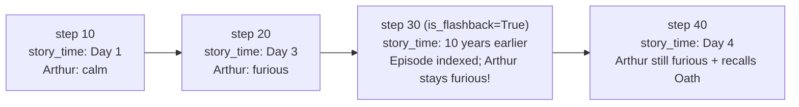
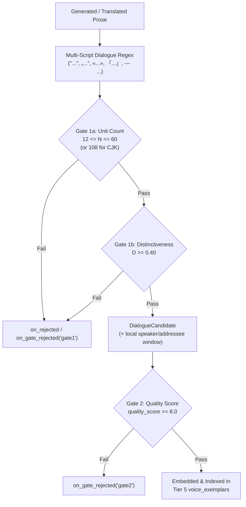
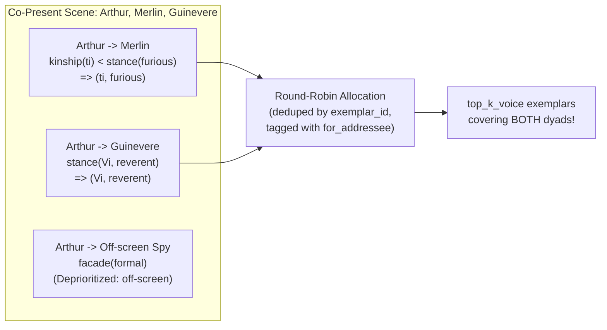
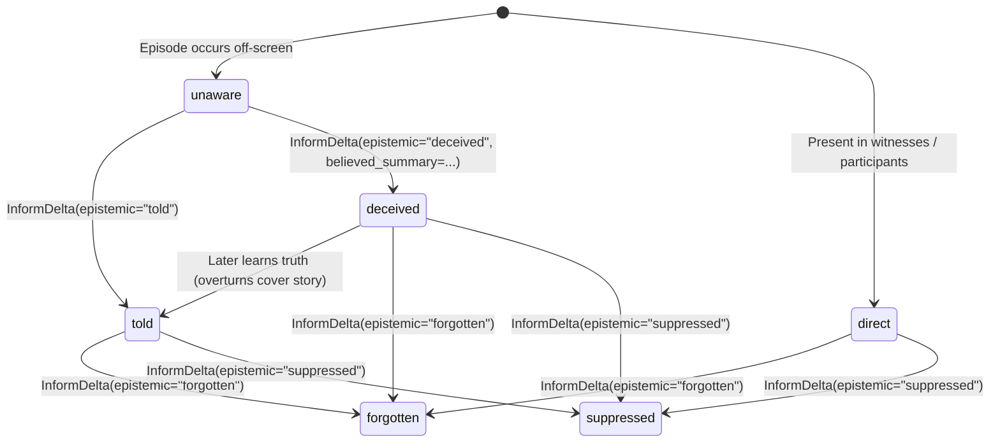
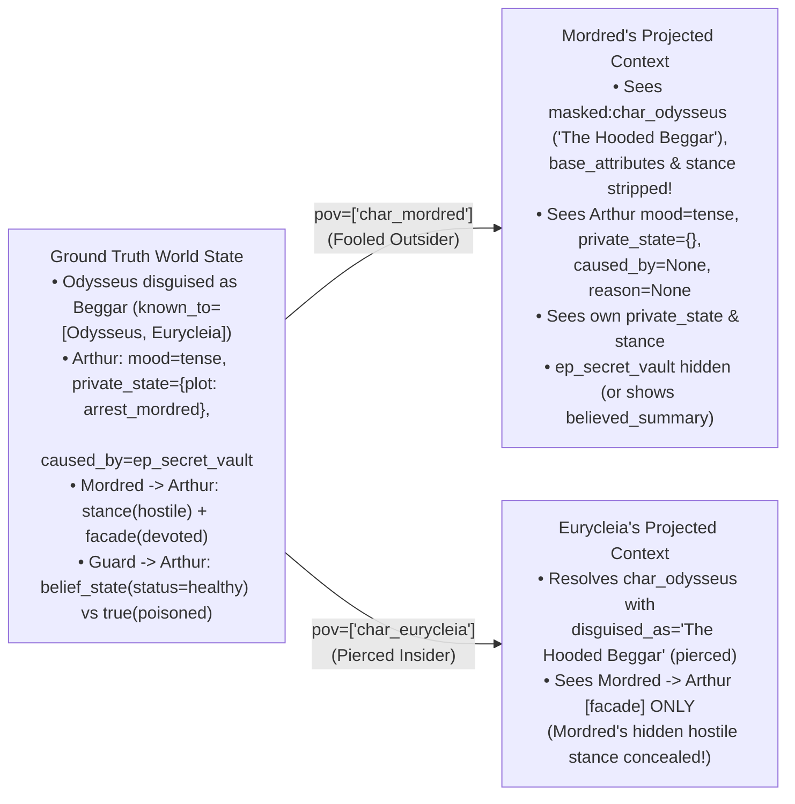
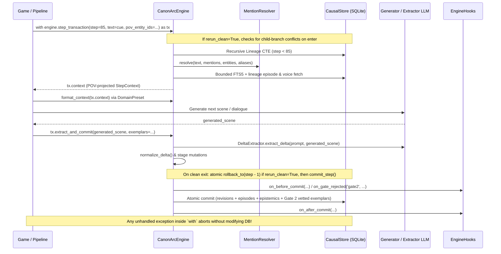

# `canonarc` Handbook: Comprehensive Tutorial & Architectural Study Book

> **A complete, ground-up guide to the design philosophy, mathematical foundations, SQLite causal lineage engine, anti-drift voice bank, epistemic POV projection, LLM extraction pipelines, and time-travel mechanics of stateful narrative intelligence.**

---

## How to Use This Book

- **Building an app right now?** Start with **Chapter 0** (motivation), skim **Chapter 1** (6-tier model), and jump to **Chapter 6** (live LLM loop) and **Chapter 7** (complete runnable Arthur & Merlin walkthrough).
- **Studying the architecture or extending `canonarc`?** Read straight through **Chapters 1–5** for the SQLite schema, recursive lineage CTE trace, Voice Bank math, 4-signal episodic ranker, and epistemic projection rules.
- **Hands-on notebooks:** Pair this book with the 4 offline-runnable Jupyter notebooks in [`examples/`](../examples/README.md).

---

## Table of Contents

1. [Chapter 0: The Problem Space, Motivation & Scope](#chapter-0-the-problem-space-motivation--scope)
2. [Chapter 1: The Core Ontological Model (The 6-Tier Superset)](#chapter-1-the-core-ontological-model-the-6-tier-superset)
3. [Chapter 2: The Storage Engine, SQLite Schema & Recursive Lineage CTE](#chapter-2-the-storage-engine-sqlite-schema--recursive-lineage-cte)
4. [Chapter 3: Causal Time Travel, Branching & Non-Linear Narrative Time](#chapter-3-causal-time-travel-branching--non-linear-narrative-time)
5. [Chapter 4: Mention Resolution, The Voice Bank, Anti-Drift Gates & Embedders](#chapter-4-mention-resolution-the-voice-bank-anti-drift-gates--embedders)
6. [Chapter 5: Tier 6 Episodic Event Ledger, Epistemic Visibility & POV Projection](#chapter-5-tier-6-episodic-event-ledger-epistemic-visibility--pov-projection)
7. [Chapter 6: The Live LLM Loop — Transactions, Extractors, Presets & Hooks](#chapter-6-the-live-llm-loop--transactions-extractors-presets--hooks)
8. [Chapter 7: End-to-End Walkthrough & CLI Debugging — The Arthur & Merlin Case Study](#chapter-7-end-to-end-walkthrough--cli-debugging--the-arthur--merlin-case-study)
9. [Chapter 8: Scaling, Benchmarks, Failure Modes & Architectural Reference](#chapter-8-scaling-benchmarks-failure-modes--architectural-reference)

---

## Chapter 0: The Problem Space, Motivation & Scope

> **Learning Objectives:** Understand the 6 architectural failure modes of chatbot memory frameworks in narrative domains, `canonarc`'s 4 design invariants, and when *not* to use `canonarc`.

### 0.1 Why Existing LLM Memory Frameworks Fail in Narratives

In the modern LLM ecosystem, memory frameworks such as `mem0`, `zep`, and `langmem` are ubiquitous. However, they were engineered primarily for **conversational support chatbots and enterprise assistants**.

When engineers apply conversational memory engines to **Interactive Fiction (IF), Visual Novels (Ren'Py / Ink), Sequential Game Localization, Multi-Agent Social Simulations, TTRPG Game Masters, or Creative Writing Co-Pilots**, the system breaks down along six architectural fault lines:



#### 1. Discrete Causal Time vs. Continuous Wall-Clock Time
- **Chatbots:** Operate on real-world timestamps (`2026-11-12T08:30:00Z`).
- **Narratives:** Operate on **discrete causal steps** (`step: int`) representing turns, scenes, chunks, or simulation ticks. Step 85 occurs strictly after Step 84, whether the player paused for 5 seconds or 3 weeks.
- **Two Independent Clocks (`step` vs. `story_time`):** Stories often jump backward in time (flashbacks) even though the reader is still moving forward through the book. `canonarc` tracks these as two separate concepts:
  - **`step` (reading / telling order):** The sequence in which scenes appear to the reader or player (`step 1` $\to$ `step 2` $\to$ `step 3`). This *always* counts upward and controls **when the audience learns a fact**.
  - **`story_time` (in-world calendar):** When an event actually happened inside the story's universe (e.g., `"Day 4"` or `"10 years earlier"`).
  - **Concrete example:** Imagine Arthur is currently `"furious"` in Chapter 3 (`step = 29`, `story_time = "Day 4"`). In Chapter 4 (`step = 30`), the story cuts to a flashback (`story_time = "10 years earlier"`) showing young Arthur taking a secret oath when he was `"naive"`. Because `step` and `story_time` are separate:
    1. **No spoilers for earlier chapters:** The oath wasn't revealed until `step = 30`, so querying `step = 20` still cannot see it.
    2. **Available going forward:** From `step = 31` onward, the engine can recall the oath.
    3. **Present-day state stays intact:** Marking the scene `is_flashback=True` records the past event without overwriting Arthur's present-day `"furious"` mood with his 10-years-ago `"naive"` mood.

#### 2. The Semantic Spoiler Trap (Temporal Incoherence)
Standard RAG indexes all chunks into one flat vector store. If a query at Chapter 2 asks *"Why is the old advisor so suspicious?"*, semantic similarity can pull a Chapter 15 revelation where the advisor is exposed as a spy. Injecting future events destroys dramatic tension and narrative causality.

#### 3. The Flat Entity Fallacy & Asymmetric Stance
Chatbots treat relationships as symmetric facts (*"Arthur and Merlin know each other"*). In drama, localization, and social simulations, relationships must be **directed**, **asymmetric**, and **typed**:
- **Directed** *(structure)*: Every edge has an explicit direction (`source_id -> target_id`), so `Arthur -> Merlin` and `Merlin -> Arthur` are stored independently.
- **Asymmetric** *(values)*: Because directions are separate, `A -> B` does not have to match `B -> A`—one character can be furious and informal while the other remains calm and formal.
- **Typed** *(multiple layers)*: Each edge carries a `relation_type` (keyed as `source_id:relation_type->target_id`), letting the same pair hold multiple concurrent relationships—such as `stance`, `facade`, `kinship`, or `belief_state`—without overwriting each other.

For example:
- **Arthur $\to$ Merlin (`stance`):** furious, informal register (`"ti"`), distrustful.
- **Merlin $\to$ Arthur (`stance`):** calm, formal register (`"Vi"`), paternal.
- **Mordred $\to$ Arthur (`facade` vs. `stance`):** outwardly devoted and formal (`facade`), secretly hostile (`stance`).

#### 4. The Self-Conditioning / Generation Drift Loop
When past LLM outputs are naively retrieved as few-shot dialogue exemplars, **Error Compounding** sets in:
1. In Scene 3, the LLM writes a bland, cliché line.
2. In Scene 7, vector retrieval surfaces that bland line as an exemplar of the character's voice.
3. The LLM imitates its own mediocrity. By Scene 20, every character sounds like generic assistant prose.

#### 5. Branching Multiverses & Zero-Latency Rollback
In games, visual novels, and counterfactual simulations:
- Players scroll backward to undo choices (`rollback_to`).
- Stories fork into parallel routes (*"Betray the King"* vs. *"Stay Loyal"*).
- Requiring a separate graph database (Neo4j), vector database (Qdrant/Pinecone), and document store just to ship a desktop game save file is operationally unviable.

#### 6. The State-Only Markovian Trap & Omniscient Metagaming
When Arthur's mood cools back to `"calm"` at Step 90, a state-only store erases the fact that he was `"furious"` at Step 82—and forgets *why*. Worse, omniscient memory leaks secret events to characters who were never in the room, causing NPCs to metagame.

### 0.2 The Four Guiding Principles of `canonarc`

1. **Single-File Zero-Ops Portability:** The entire multiverse of timelines, graph revisions, episodic events, FTS5 indexes, and embeddings resides in one standard SQLite file (`story.sqlite` or `:memory:`). Dependencies are minimal (`pydantic`, `numpy`, `rapidfuzz`, stdlib `sqlite3`). *([Chapter 2](#chapter-2-the-storage-engine-sqlite-schema--recursive-lineage-cte))*
2. **Strict Causal Lineage Boundary (No Spoilers):** When generating Step 10, the engine only sees history from earlier steps ($\text{record.step} < \text{step}$, `inclusive=False`), so future events can never leak backward. Pass `inclusive=True` only when you intentionally want to inspect the state *after* Step 10 commits. *([Chapter 2](#chapter-2-the-storage-engine-sqlite-schema--recursive-lineage-cte), [Chapter 3](#chapter-3-causal-time-travel-branching--non-linear-narrative-time))*
3. **Deterministic Linguistic & Voice Gating (No Drift):** Past dialogue is not blindly recycled as style examples—lines must first pass length and distinctiveness checks (**Gate 1**) and a quality threshold (**Gate 2**) before being saved. At retrieval time, hard rules like grammatical register (`Vi` vs. `ti`) are enforced before vector similarity ranking. *([Chapter 4](#chapter-4-mention-resolution-the-voice-bank-anti-drift-gates--embedders))*
4. **Epistemic & Causal Grounding (No Metagaming):** Story events are stored as dedicated multi-character (*N-ary*) records linked to the state changes they caused (`caused_by_episode_id`). Each event also tracks *who actually knows about it* (`direct`, `told`, `deceived`, `forgotten`, `suppressed`), letting you filter the entire world through one character's point of view (**POV projection**). *([Chapter 5](#chapter-5-tier-6-episodic-event-ledger-epistemic-visibility--pov-projection))*

### 0.3 When *Not* to Use `canonarc`

> [!NOTE]
> `canonarc` is intentionally scoped to storyworlds, simulations, and discrete-step pipelines. Choose a different tool for:
> - **Continuous wall-clock CRM / enterprise chatbot logs:** Systems centered on real-world bi-temporal timestamps (`t_valid`/`t_invalid`) like Graphiti or Zep are a better fit.
> - **Million-document static corpus RAG or arbitrary multi-hop Cypher/PageRank QA:** `canonarc` uses SQLite FTS5 pre-filtering + in-memory NumPy scoring over storyworld-scale histories and 1-hop graph expansion. Use a dedicated vector DB or full graph DB for static web-scale corpora.

---

## Chapter 1: The Core Ontological Model (The 6-Tier Superset)

> **Learning Objectives:** Master the 6-tier data hierarchy in [`src/canonarc/models.py`](../src/canonarc/models.py), understand how each Pydantic model maps to a tier, and see how causal provenance connects state to events.

`canonarc` models narrative state as a **6-Tier Architectural Superset**. Rather than flattening everything into text chunks or a single JSON blob, each kind of narrative truth lives at its natural level of abstraction:



**Reading the ER Diagram (`||--o{` means "one-to-many", i.e., one left record can link to zero or many right records):**

- **The 6 Nodes (Core Records):**
  - **`ENTITY_RECORD`** — A thing in the story world: character, location, faction, artifact, or term (e.g., *Arthur*, *Merlin*, *Excalibur*).
  - **`ALIAS_RECORD`** — An alternate name, title, epithet, or disguise resolving to an entity (e.g., `"the old wizard"` or `"the grey pilgrim"` $\to$ *Merlin*).
  - **`DIRECTED_EDGE`** — A one-way, typed relationship from one entity to another (e.g., `Arthur --[stance]--> Merlin`).
  - **`VOICE_EXEMPLAR`** — A vetted historical dialogue line in the Tier 5 Voice Bank (text, speaker, addressee, register, tone).
  - **`EPISODE_RECORD`** — A plot event (e.g., `ep_arg_82`: *"Arthur confronted Merlin over the concealed dragon prophecy"*).
  - **`EPISODE_EPISTEMIC`** — A bridge/join record storing *how* a specific character knows about a specific event (`direct`, `told`, `deceived`, `forgotten`, `suppressed`).

- **The 7 Edges (Relationships):**

| Relationship | Meaning | Example |
| :--- | :--- | :--- |
| `ENTITY_RECORD \|\|--o{ ALIAS_RECORD` | One entity can have many aliases or disguises. | Merlin has `"the old wizard"` and `"the grey pilgrim"`. |
| `ENTITY_RECORD \|\|--o{ DIRECTED_EDGE` | One entity can hold many outgoing/incoming directed relationships. | Arthur has a `stance` edge to Merlin; Mordred has both a `stance` and a `facade` edge to Arthur. |
| `ENTITY_RECORD \|\|--o{ VOICE_EXEMPLAR` | One character can have many saved dialogue examples (as `speaker_id` or `addressee_id`). | Arthur has formal lines to Merlin and furious lines to Merlin. |
| `EPISODE_RECORD \|\|--o{ ENTITY_RECORD` | One event can **cause** many entity state updates (via `caused_by_episode_id`). | `ep_arg_82` caused `Arthur.mood` to become `"furious"`. |
| `EPISODE_RECORD \|\|--o{ DIRECTED_EDGE` | One event can also **cause** many relationship updates (via `caused_by_episode_id`). | `ep_arg_82` also caused `Arthur -> Merlin` trust to drop. |
| `EPISODE_RECORD \|\|--o{ EPISODE_EPISTEMIC` | One event has many per-character knowledge entries. | For `ep_arg_82`: Arthur = `direct`, Merlin = `direct`, Mordred = `deceived`. |
| `ENTITY_RECORD \|\|--o{ EPISODE_EPISTEMIC` | One character (observer) has many knowledge entries across different events. | Mordred has `deceived` for `ep_arg_82`, `direct` for `ep_banquet_12`, etc. |

```
┌───────────────────────────────────────────────────────────────────┐
│ Tier 6: Episodic Event Ledger (N-ary Events, Provenance, POV)     │
├───────────────────────────────────────────────────────────────────┤
│ Tier 5: Gated Voice Bank (Empirical Style & Syntax Anchors)       │
├───────────────────────────────────────────────────────────────────┤
│ Tier 4: Temporal Versioning, 1-Hop Coreference & Scene Partition  │
├───────────────────────────────────────────────────────────────────┤
│ Tier 3: Rolling State Deltas & Windowed Trajectories (prior_state)│
├───────────────────────────────────────────────────────────────────┤
│ Tier 2: Pairwise Directed Edges (stance, facade, belief_state...) │
├───────────────────────────────────────────────────────────────────┤
│ Tier 1: Base Entity Attributes (Immutable Archetypes & Grammar)   │
└───────────────────────────────────────────────────────────────────┘
```

### Tier 1: Base Entity Attributes (`EntityRecord.base_attributes`)
Entities represent characters, factions, locations, artifacts, or glossary terms (`kind: str = "character"`). Tier 1 attributes are seeded at `step = 0` and hold baseline invariants:
- Grammatical gender, declension class, and target-language exonyms (`"Arthur"` $\to$ `"Artur"`).
- Character archetypes, titles, and persistent physical traits.

```python
from canonarc import EntityRecord

arthur = EntityRecord(
    entity_id="char_arthur",
    kind="character",
    canonical_name="Arthur",
    base_attributes={"target_name": "Artur", "gender": "M", "declension": "type_1", "title": "King"},
    state={"mood": "calm", "location_id": "loc_council_chamber"},
    private_state={"secret_fear": "merlin_betrayal"},  # Hidden from non-POV observers
)
```

### Tier 2: Pairwise Directed Edges (`DirectedEdgeRecord`)
Relationships are directed, typed multigraph edges keyed by `source_id:relation_type->target_id`. Because `relation_type` is part of the key, a single pair of characters can simultaneously hold multiple independent edges:
- `stance`: Private interpersonal attitude and grammatical register (e.g., `register: "ti" | "Vi"`, `tone: "furious"`, `trust: -0.6`).
- `facade`: Outwardly performed politeness or loyalty that conceals a private `stance` from non-POV observers.
- `belief_state`: What `source_id` *believes* `target_id`'s state to be (e.g., believing a captured ally is still `"alive"`).
- Domain-specific types: `kinship`, `debt`, `allegiance`, `holds` (inventory).

```python
from canonarc import EdgeDelta

# Arthur -> Merlin: informal & furious; Merlin -> Arthur remains independent
arthur_to_merlin = EdgeDelta(
    source_id="char_arthur",
    target_id="char_merlin",
    relation_type="stance",
    state={"register": "ti", "tone": "furious", "trust": -0.5},
    caused_by_episode_id="ep_arg_82",
    reason="Discovered Merlin concealed the dragon prophecy",
)
```

### Tier 3: Rolling State Deltas & Windowed Trajectories (`EntityDelta`, `EdgeDelta`, `StepDelta`)
`canonarc` uses **Resolve-on-Write** materialization: when `apply_delta()` receives `EntityDelta(entity_id="char_arthur", state={"mood": "calm"})` (with `merge_state=True`), it fetches Arthur's active state along the lineage, merges the patch, and appends a complete materialized JSON snapshot into `graph_revisions`.

On read, SQL window functions automatically populate three trajectory fields on every `EntityRecord` and `DirectedEdgeRecord`:
- `prior_state`: The state dictionary immediately before the current revision.
- `prior_step`: The causal step at which `prior_state` took effect.
- `revision_count`: Total number of revisions along this lineage up to the query step.

When Arthur cools to `"calm"` at Step 90, the prompt automatically renders `mood: calm (was: furious at step 82)` without a second database query.

> [!TIP]
> To remove an entity or close an edge (such as transferring an exclusive item to another character), pass `remove=True` on `EntityDelta` or `EdgeDelta`. This appends a **tombstone** (`is_tombstone = 1`) at the current step—erasing it from future queries while keeping history before that step intact for time travel.

### Tier 4: Temporal Versioning, 1-Hop Coreference & Scene Partitioning (`AliasRecord`, `StepContext`)
Tier 4 resolves surface epithets, titles, and disguises (`"the old wizard"` $\to$ `char_merlin`) via `AliasRecord`:

```python
from canonarc import AliasRecord

disguise = AliasRecord(
    alias="the hooded beggar",
    entity_id="char_odysseus",
    kind="disguise",                      # "permanent" | "epithet" | "disguise" | "title"
    known_to=["char_odysseus", "char_eurycleia"],  # None = universally known
    persona_name="The Hooded Beggar",
)
```

During `retrieve_context()`, Tier 4 cleanly partitions the resolved graph into two zones inside `StepContext`:
- **Co-present scene (`ctx.entities`, `ctx.active_edges`):** Characters matched in `text`/`mentions`, sharing the active `location_id`, or included via `fallback_on_empty_mentions`. Only these characters appear in active scene blocks and `| ignorant:` dramatic irony tags.
- **1-hop off-screen neighbors (`ctx.related_entities`, `ctx.background_edges`):** Characters connected by an edge to someone in the scene, but not physically present. Keeping them separate prevents off-screen characters from polluting scene presence or causal episode pinning.

### Tier 5: Gated Dynamic Voice Bank (`VoiceExemplar`, `DialogueCandidate`)
Stores vetted historical dialogue lines with `speaker_id`, optional `addressee_id`, `metadata` (such as `register` and `tone`), `quality_score`, `distinctiveness_score`, and a float32 embedding vector. Covered in depth in **Chapter 4**.

### Tier 6: Episodic Event Ledger (`EpisodeRecord`, `InformDelta`)
Stores immutable N-ary plot events with semantic participant roles (`participants={"char_arthur": "giver", "item_excalibur": "instrument", "char_lancelot": "recipient"}`), `witnesses`, optional diegetic coordinates (`story_time`, `chapter_id`, `scene_id`), `salience` ($\in [0.0, 10.0]$), `consolidated_from`, and per-observer epistemic modes (`direct`, `told`, `deceived`, `forgotten`, `suppressed`). Covered in depth in **Chapter 5**.

---

## Chapter 2: The Storage Engine, SQLite Schema & Recursive Lineage CTE

> **Learning Objectives:** Understand the 7 SQLite tables in [`src/canonarc/store.py`](../src/canonarc/store.py), why different tiers use different primary-key strategies, and trace the recursive lineage CTE row by row.

### 2.1 The 7-Table SQLite Schema

Every `canonarc` save file is a standard SQLite database (WAL-friendly, zero external servers) containing seven tables:

```sql
-- 1. Copy-on-Write Timeline Tree (DAG of branches)
CREATE TABLE IF NOT EXISTS timelines (
    timeline_id TEXT PRIMARY KEY,
    parent_id   TEXT REFERENCES timelines(timeline_id),
    fork_step   INTEGER,
    metadata    TEXT NOT NULL DEFAULT '{}'
);

-- 2. Unified Append-Only Materialized Revisions (Entities, Typed Edges, Aliases)
CREATE TABLE IF NOT EXISTS graph_revisions (
    revision_id   INTEGER PRIMARY KEY AUTOINCREMENT,
    timeline_id   TEXT NOT NULL REFERENCES timelines(timeline_id),
    step          INTEGER NOT NULL,
    record_type   TEXT NOT NULL, -- 'entity' | 'edge' | 'alias'
    subject_key   TEXT NOT NULL, -- 'char_arthur' | 'char_arthur:stance->char_merlin' | 'char_merlin:the old wizard'
    relation_type TEXT,          -- 'stance', 'facade', 'belief_state', 'kinship'; NULL for entity/alias
    source_id     TEXT,
    target_id     TEXT,
    is_tombstone  INTEGER NOT NULL DEFAULT 0,
    payload       TEXT NOT NULL  -- Full materialized JSON snapshot
);
CREATE INDEX IF NOT EXISTS idx_revisions_lookup
    ON graph_revisions(timeline_id, record_type, subject_key, step DESC, revision_id DESC);

-- 3. Tier 5 Voice Exemplars (Composite PK allows same exemplar_id across forked branches)
CREATE TABLE IF NOT EXISTS voice_exemplars (
    exemplar_id           TEXT NOT NULL,
    timeline_id           TEXT NOT NULL REFERENCES timelines(timeline_id),
    step                  INTEGER NOT NULL,
    speaker_id            TEXT NOT NULL,
    addressee_id          TEXT,
    text                  TEXT NOT NULL,
    source_text           TEXT NOT NULL DEFAULT '',
    metadata              TEXT NOT NULL DEFAULT '{}',
    quality_score         REAL NOT NULL,
    distinctiveness_score REAL NOT NULL,
    embedding             BLOB NOT NULL,
    PRIMARY KEY (timeline_id, exemplar_id)
);

-- 4. Tier 6 Episodic Event Ledger
CREATE TABLE IF NOT EXISTS episodes (
    episode_id   TEXT NOT NULL,
    timeline_id  TEXT NOT NULL REFERENCES timelines(timeline_id),
    step         INTEGER NOT NULL,
    predicate    TEXT NOT NULL DEFAULT 'event',
    summary      TEXT NOT NULL,
    location_id  TEXT,
    salience     REAL NOT NULL DEFAULT 5.0,
    participants TEXT NOT NULL DEFAULT '{}',
    witnesses    TEXT NOT NULL DEFAULT '[]',
    metadata     TEXT NOT NULL DEFAULT '{}',
    embedding    BLOB NOT NULL DEFAULT X'',
    PRIMARY KEY (timeline_id, episode_id)
);

-- 5. Tier 6 Epistemic Awareness Log (append-only per timeline/step)
CREATE TABLE IF NOT EXISTS episode_epistemics (
    id               INTEGER PRIMARY KEY AUTOINCREMENT,
    timeline_id      TEXT NOT NULL REFERENCES timelines(timeline_id),
    step             INTEGER NOT NULL,
    episode_id       TEXT NOT NULL,
    entity_id        TEXT NOT NULL,
    epistemic        TEXT NOT NULL DEFAULT 'direct', -- direct | told | deceived | forgotten | suppressed
    believed_summary TEXT
);

-- 6. SQLite FTS5 Virtual Table (kept in sync via AFTER INSERT / DELETE / UPDATE triggers)
CREATE VIRTUAL TABLE IF NOT EXISTS episodes_fts USING fts5(
    timeline_id UNINDEXED,
    episode_id  UNINDEXED,
    summary
);

-- 7. Store Metadata (embedder_id & embedding_dim provenance)
CREATE TABLE IF NOT EXISTS store_metadata (
    key   TEXT PRIMARY KEY,
    value TEXT NOT NULL
);
```

**Why these design choices matter:**
- **Append-only `graph_revisions` + `is_tombstone`:** Because rows are never updated in place, point-in-time queries at *any* historical step are deterministic and rollback is a single indexed `DELETE WHERE step > :cutoff`.
- **Composite primary keys `(timeline_id, episode_id)` and `(timeline_id, exemplar_id)`:** Two divergent branches can independently generate or modify the same logical ID without colliding in SQLite.
- **`episodes_fts` + bounded SQL pre-filtering:** On long-running campaigns (hundreds or thousands of episodes), `CausalStore.get_lineage_episodes(..., limit=...)` narrows candidates directly inside SQLite—combining POV visibility, pinned causal provenance IDs, participant/witness/location overlap, and FTS5 summary matches—before Python/NumPy ever scores embeddings.

### 2.2 The Recursive Lineage CTE (Line-by-Line Architecture)

Resolving the entire active world state *and* each record's preceding trajectory (`prior_state`, `prior_step`, `revision_count`) happens in **one SQLite query**:

```sql
WITH RECURSIVE lineage(timeline_id, parent_id, max_step, depth) AS (
    -- Anchor: start at the requested timeline with depth = 0
    SELECT timeline_id, parent_id, :cutoff_step, 0
    FROM timelines
    WHERE timeline_id = :timeline_id
    UNION ALL
    -- Recursive step: walk upward to parent, clamping parent visibility at fork_step
    SELECT
        t.timeline_id,
        t.parent_id,
        CASE
            WHEN l.max_step IS NULL THEN t_child.fork_step
            WHEN t_child.fork_step IS NULL THEN l.max_step
            ELSE MIN(l.max_step, t_child.fork_step)
        END,
        l.depth + 1
    FROM lineage l
    JOIN timelines t_child ON t_child.timeline_id = l.timeline_id
    JOIN timelines t       ON t.timeline_id = l.parent_id
    WHERE l.parent_id IS NOT NULL
),
step_deduped AS (
    -- Stage 1: If a child branch overrides a key at the exact same step as its parent,
    -- keep only the lowest-depth (closest branch) latest revision for that step.
    SELECT
        r.*,
        l.depth,
        ROW_NUMBER() OVER (
            PARTITION BY r.record_type, r.subject_key, r.step
            ORDER BY l.depth ASC, r.revision_id DESC
        ) AS step_rn
    FROM graph_revisions r
    JOIN lineage l
      ON r.timeline_id = l.timeline_id
     AND (l.max_step IS NULL OR r.step <= l.max_step)
),
ranked_revisions AS (
    -- Stage 2: Rank deduplicated revisions per subject_key & attach trajectory via LEAD()
    SELECT
        revision_id, timeline_id, step AS valid_from_step,
        record_type, subject_key, relation_type, source_id, target_id,
        is_tombstone, payload,
        ROW_NUMBER() OVER (
            PARTITION BY record_type, subject_key
            ORDER BY depth ASC, step DESC, revision_id DESC
        ) AS rn,
        COUNT(*) OVER (
            PARTITION BY record_type, subject_key
        ) AS revision_count,
        LEAD(payload) OVER (
            PARTITION BY record_type, subject_key
            ORDER BY depth ASC, step DESC, revision_id DESC
        ) AS prior_payload,
        LEAD(step) OVER (
            PARTITION BY record_type, subject_key
            ORDER BY depth ASC, step DESC, revision_id DESC
        ) AS prior_step,
        LEAD(is_tombstone) OVER (
            PARTITION BY record_type, subject_key
            ORDER BY depth ASC, step DESC, revision_id DESC
        ) AS prior_is_tombstone
    FROM step_deduped
    WHERE step_rn = 1
)
SELECT record_type, subject_key, relation_type, source_id, target_id, valid_from_step,
       payload, revision_count, prior_payload, prior_step, prior_is_tombstone
FROM ranked_revisions
WHERE rn = 1 AND is_tombstone = 0;
```

### 2.3 Worked Visual Trace of the CTE

Suppose we have a branch `alt` forked from `main` at `fork_step = 20`, and we query `alt` at `cutoff_step = 30` for `char_arthur`:

```mermaid
flowchart LR
    subgraph Input["graph_revisions rows for char_arthur"]
        R1["rev 1 | main | step 0 | calm"]
        R2["rev 2 | main | step 20 | suspicious"]
        R3["rev 3 | main | step 25 | furious"]
        R4["rev 4 | alt  | step 20 | trusting"]
        R5["rev 5 | alt  | step 28 | resolute"]
    end

    subgraph S1["1. lineage CTE (alt, cutoff=30)"]
        L0["alt: depth=0, max_step=30"]
        L1["main: depth=1, max_step=MIN(30,20)=20"]
    end

    subgraph S2["2. step_deduped (step_rn = 1)"]
        D1["rev 5 | alt  | step 28 | depth 0"]
        D2["rev 4 | alt  | step 20 | depth 0 (beats rev 2!)"]
        D3["rev 1 | main | step 0  | depth 1"]
    end

    subgraph S3["3. ranked_revisions (rn = 1)"]
        F["valid_from_step=28 | mood=resolute\nprior_step=20 | prior_state=trusting\nrevision_count=3"]
    end

    Input --> S1 --> S2 --> S3
```



Look closely at what just happened:
1. **`rev 3` (`main`, step 25)** is **dropped** because `main`'s `max_step` is clamped to `fork_step = 20`. Future commits on `main` never bleed into `alt`.
2. **`rev 2` (`main`, step 20)** is **deduplicated** by `step_deduped` (`step_rn = 2`) because `alt` (`depth = 0`) also wrote `char_arthur` at step 20 (`rev 4`). Without `step_deduped`, `LEAD()` would have falsely reported `main`'s `"suspicious"` as `prior_state` and inflated `revision_count` to 4!
3. **`rn = 1 AND is_tombstone = 0`** selects `rev 5` (`"resolute"`), while `LEAD()` attaches `prior_state = {"mood": "trusting"}` at `prior_step = 20` and `revision_count = 3`.

---

## Chapter 3: Causal Time Travel, Branching & Non-Linear Narrative Time

> **Learning Objectives:** Use zero-copy branching, `< 1ms` rollback, branch conflict safety, concurrency-safe timeline sessions, counterfactual diffs, save-slot snapshots, and flashback-safe ingestion.

### 3.1 Zero-Copy Branching & Instant Rollback

Branching inserts **one row** into `timelines`—zero entity, edge, voice, or episode rows are copied:



```python
from canonarc import CanonArcEngine, TimelineBranchConflictError

with CanonArcEngine("save.sqlite") as engine:
    # Fork an alternate route at Step 20 without copying any data
    engine.branch(at_step=20, name="dark_pact", switch=True)

    # Rewind 'dark_pact' to Step 25 (deletes graph_revisions, voice_exemplars,
    # episodes, and episode_epistemics at step > 25 atomically)
    deleted = engine.rollback_to(step=25, timeline_id="dark_pact")

    # Safety guard: rolling 'main' back past a child's fork_step raises an error
    try:
        engine.rollback_to(step=10, timeline_id="main")
    except TimelineBranchConflictError:
        # Either prune the child branch first or pass force=True
        engine.delete_timeline("dark_pact", cascade=True)
        engine.rollback_to(step=10, timeline_id="main")
```

> [!WARNING]
> **Branch Conflict Protection:** Rolling `main` back to Step 10 when `dark_pact` forked at Step 20 would silently amputate `dark_pact`'s inherited history. `canonarc` raises `TimelineBranchConflictError` unless you explicitly pass `force=True` or delete the descendant branch first with `delete_timeline("dark_pact", cascade=True)`.

### 3.2 Concurrency-Safe Timeline Sessions (`use_timeline` & `session`)

In web servers, async game backends, or parallel Tree-of-Thought planners, calling `engine.checkout(...)` mutates global engine state and creates race conditions. `canonarc` provides two concurrency-safe alternatives:

```python
# 1. Task-local ContextVar scoping (safe across asyncio tasks)
with engine.use_timeline("dark_pact") as tl:
    ctx = engine.retrieve_context(step=30, mentions=["Arthur"])
    tl.commit_step(step=30, delta=my_delta)

# 2. Explicit immutable TimelineSession handle (passable between functions)
route_a = engine.session("main")
route_b = engine.session("dark_pact")
ctx_a = route_a.retrieve_context(step=30, mentions=["Arthur"])
ctx_b = route_b.retrieve_context(step=30, mentions=["Arthur"])
```

### 3.3 Counterfactual Diffs & Portable Save-Slot Snapshots

- **Compare two timelines at any step:**
  ```python
  diff = engine.diff_timelines("main", "dark_pact", at_step=50)
  # Returns: {"only_in_a": [...], "only_in_b": [...], "changed": [...], "identical": [...]}
  ```
- **Export a standalone save slot:**
  ```python
  engine.export_snapshot("saves/slot_01.sqlite", at_step=50, timeline_id="dark_pact")
  ```
  `export_snapshot()` flattens the resolved lineage state at `at_step=50` onto a standalone `'main'` timeline in `slot_01.sqlite` (preserving original step numbers, `prior_state` trajectories, `revision_count`, voice exemplars, lineage episodes, and `episode_epistemics`) so the file can be archived, emailed, or loaded independently.

### 3.4 Non-Linear Narrative Time & Flashbacks (`is_flashback=True`)

Stories frequently jump backward in diegetic time while advancing forward in discourse order (`step`):



```python
from canonarc import EpisodeRecord, StepDelta

engine.commit_step(
    step=30,
    delta=StepDelta(
        is_flashback=True,
        story_time="10 years earlier",
        chapter_id="ch_04",
        scene_id="flashback_citadel",
        episodes=[
            EpisodeRecord(
                episode_id="ep_citadel_oath",
                predicate="oath",
                summary="Young Arthur swore the Secret Citadel Oath before Merlin.",
                participants={"char_arthur": "actor", "char_merlin": "witness"},
                witnesses=["char_arthur", "char_merlin"],
                salience=8.5,
            )
        ],
    ),
)
```

When `is_flashback=True`:
- All edges and any mutations to already-existing entities are **skipped**, so present-day moods, states, and stances are never overwritten with historical flashback values.
- Brand-new flashback-only entities (along with their aliases), episodes, and `InformDelta` records *are* indexed normally so present-day characters can recall the flashback at Step 40.

---

## Chapter 4: Mention Resolution, The Voice Bank, Anti-Drift Gates & Embedders

> **Learning Objectives:** Understand how `DefaultLexicalResolver` links text to entities, the exact mathematics of Gate 1 / Gate 2 and Voice Bank scoring, multi-party dyadic voice resolution, and embedder migration.

### 4.1 Mention Resolution & 1-Hop Coreference ([`resolver.py`](../src/canonarc/resolver.py))

Before retrieving edges, episodes, or voice lines, `CanonArcEngine.retrieve_context()` runs its `MentionResolver` (default: `DefaultLexicalResolver(fuzzy_threshold=88.0)`):

1. **Explicit mentions** (`mentions=["Arthur", "the old wizard"]`) are matched against canonical names and active aliases.
2. **Word-boundary text scan** scans `text` longest-phrase-first (`(?<!\w)phrase(?!\w)`, with CJK-aware boundary relaxation) so `"the old wizard"` is not shadowed by `"wizard"`.
3. **Fuzzy inflection fallback** (optional, via `rapidfuzz`) catches inflected names in morphologically rich languages (e.g., Slavic/Germanic case endings like `"Arturu"` $\to$ `"Artur"`).
4. **Empty-mention fallback** (`fallback_on_empty_mentions`):
   - `"pov_only"` *(default)*: If no entity is mentioned in `text`, fall back to `pov_entity_ids` (or return an empty scene if no POV is set).
   - `"all"`: Load all active entities (useful for CLI `inspect`).
   - `"none"`: Return an empty scene if nothing matched.

### 4.2 The Two-Stage Anti-Drift Gate ([`voice.py`](../src/canonarc/voice.py))

To stop LLM self-conditioning drift, `IngestionGate` filters candidate dialogue before it ever enters SQLite:



#### Mathematical Definition of Gate 1 Distinctiveness
Let $N$ be the token/unit count of a dialogue span, $|V|$ the number of unique units, and $B_{\text{div}} = \frac{|\text{unique bigrams}|}{\max(1, N - 1)}$. Define the **Root Type-Token Ratio**:

$$\text{Root-TTR} = \frac{|V|}{\sqrt{N}}$$

- **Latin / Cyrillic / Space-delimited scripts** (with long-word ratio $L_6 = \frac{|\{w : |w| \ge 6\}|}{N}$):
  $$D = \min\!\left(1.0,\; 0.55 \cdot \frac{\text{Root-TTR}}{5.0} + 0.25 \cdot L_6 + 0.20 \cdot B_{\text{div}}\right)$$
- **CJK scripts** (ideographs, Kana, Hangul):
  $$D_{\text{CJK}} = \min\!\left(1.0,\; 0.60 \cdot \frac{\text{Root-TTR}}{5.0} + 0.40 \cdot B_{\text{div}}\right)$$

Short filler lines (*"Yes, my lord."*) fail the unit count bound; repetitive generic lines fail $D \ge 0.40$.

Inside `engine.step_transaction(...)`, `tx.harvest_voice(text, *, source_text="", lang=None, scorer=None)` automates both gates end-to-end: it runs Gate 1, resolves active dyadic edge metadata (`register`, `tone`, `facade` overrides, and speaker `disguise` → `persona`, overlaying any `StepDelta` staged earlier in the same transaction), scores candidates via `VoiceQualityScorer` (defaulting to the zero-LLM `HeuristicVoiceQualityScorer`, with optional `CallableVoiceQualityScorer` or batched `LLMVoiceQualityScorer`), and stages passing `VoiceExemplar`s for atomic commit.

### 4.3 Voice Bank Retrieval Cascade & Multi-Party Dyadic Resolution

When retrieving exemplars for a speaker, `VoiceBank` applies a policy-driven cascade governed by `SchemaPolicy`:

1. **Causal Cutoff:** Only exemplars along the active lineage with `step <= cutoff_step`.
2. **Hard Attribute Filter** (`policy.hard_filter_keys`, default `("register",)`):
   - If the active edge specifies `register="Vi"`, exemplars tagged `register="ti"` are **excluded**.
   - **Sparse Fallback:** If strict filtering leaves zero candidates and `policy.fallback_on_empty_hard_filter=True`, mismatched candidates are reconsidered with a configurable penalty (`policy.hard_filter_mismatch_penalty`).
3. **Composite Score:**
   $$\text{Score}(q, e) = \text{CosineSim}(q, e) + \sum_{k \in \text{soft\_boost\_weights}} w_k \cdot \mathbb{I}(\text{match}_k) + w_{\text{addr}} \cdot \mathbb{I}(\text{addressee match}) + w_{\text{qual}} \cdot \frac{\text{quality}}{10} - \text{penalty}$$

#### Multi-Party Scenes (`rank_exemplars_for_targets`)
Consider a room with **Arthur**, **Merlin** (`ti`, `furious`), and **Guinevere** (`Vi`, `reverent`). Collapsing Arthur's outgoing edges to one target would lock him into a single register. Instead, `canonarc` resolves voice **per dyad**:



- **Per-Pair Layer Merge (`base < stance < facade`):** Split attributes combine cleanly per `(speaker_id, target_id)`, and a `facade` toward one addressee never leaks into a `stance` toward someone else.
- **Masked Speakers (`masked:<id>`):** Restricted exclusively to outward `facade` edges so hidden `stance` registers never betray a disguised character.

### 4.4 Embedders, CJK Tokenization & Mismatch Migration ([`embedders.py`](../src/canonarc/embedders.py))

Out of the box, `OfflineNgramEmbedder(dim=128)` requires zero network calls or ML runtimes:
- Tokenizes Latin/Cyrillic words, individual CJK characters + adjacent CJK bigrams, and character 3-grams.
- Uses **Weinberger signed CRC32 feature hashing** (`zlib.crc32` for both bucket index and `±1` sign bit), which cancels hash-collision bias and is 100% deterministic across Python processes (unlike `hash()`).

For semantic dense embeddings, plug in any adapter:
- `CallableEmbedder(fn, batch_fn=..., embedder_id=..., dim=...)` (e.g., `SentenceTransformer.encode`)
- `OpenAICompatibleEmbedder(model="text-embedding-3-small", base_url=..., api_key=...)`
- `OllamaEmbedder(model="nomic-embed-text")`

`CausalStore` records `embedder_id` and `embedding_dim` in `store_metadata`. Reopening a database with a different embedder is controlled by `on_embedder_mismatch`:
- `"warn"` *(default)*: Emits a `UserWarning`.
- `"raise"`: Raises `EmbedderMismatchError` immediately (catches both dimension changes and same-dimension model swaps).
- `"reindex"`: Automatically runs `engine.reindex_embeddings(batch_size=128)` on startup.
- `"ignore"`: Skips the startup check.

---

## Chapter 5: Tier 6 Episodic Event Ledger, Epistemic Visibility & POV Projection

> **Learning Objectives:** Model asymmetric character knowledge across all 5 `EpistemicMode` states, enforce anti-metagaming via POV projection, understand deceived-POV vector isolation, tune the 4-signal episodic ranker, and compact old history.

### 5.1 The Five Epistemic Modes (`EpistemicMode`)

Every Tier 6 `EpisodeRecord` tracks per-character knowledge in `episode_epistemics` over time:



| Mode | Meaning | Effect under `retrieve_context(pov_entity_ids=[...])` |
| :--- | :--- | :--- |
| `"direct"` | Firsthand witness | Visible; `ep.known_by[cid] == "direct"`. |
| `"told"` | Learned secondhand via `inform_entity()` / `InformDelta` | Visible; `ep.known_by[cid] == "told"`. |
| `"deceived"` | Fed a false cover story (`believed_summary`) | Visible, **but** `ep.summary` is replaced with `believed_summary` and semantic scoring embeds `believed_summary` instead of ground-truth `emb_bytes`. |
| `"forgotten"` | Natural memory loss at `step >= inform_step` | Removes prior awareness; invisible to observer. |
| `"suppressed"` | Magical / neural / administrative wipe | Removes prior awareness; invisible to observer. |

> [!CAUTION]
> **Why Deceived-POV Vector Isolation Matters:** If Mordred is told *"Merlin burned the egg in the northern furnace"* while the ground truth is *"Merlin hid the egg in the altar vault"*, scoring against the stored ground-truth embedding would let an adversarial query mentioning `"altar vault"` surface the episode to Mordred. `DefaultEpisodeRanker` discards stored `emb_bytes` whenever `effective_summary != ep.summary` and embeds `believed_summary` on the fly—guaranteeing **zero ground-truth vector leakage**.

### 5.2 POV Projection Across Tiers 1–6 (`_project_pov_state`)

Passing `pov_entity_ids=["char_mordred"]` projects the **entire 6-tier world state** through that observer's eyes:



**Multi-POV Modes (`pov_mode`):**
- `pov_mode="any"` *(default — union)*: Visible if **at least one** POV entity knows it. Ideal for third-person group narration where `| ignorant: char_lancelot` tags enable dramatic irony.
- `pov_mode="all"` *(intersection — common knowledge)*: Visible **only if every** POV entity knows it. Ideal for shared-knowledge summaries or dialogue where neither character should accidentally reveal a secret the other doesn't know.

### 5.3 The 4-Signal Tier 6 Episodic Ranker Math ([`episodic.py`](../src/canonarc/episodic.py))

`DefaultEpisodeRanker` ranks POV-eligible candidates using `EpisodicScoringPolicy`:

$$\text{Score}(e) = \underbrace{w_{\text{prov}} \cdot \mathbb{I}(e \in P)}_{\text{Causal Pin}} + \underbrace{S_{\text{overlap}}(e)}_{\text{Entity Co-occurrence}} + \underbrace{w_{\text{loc}} \cdot \mathbb{I}(\text{loc}_e \in E_{\text{scene}})}_{\text{Location Cue}} + \underbrace{w_{\text{sem}} \cdot \max(0, \cos(q, e_{\text{eff}}))}_{\text{POV-Safe Semantic Sim}} + \underbrace{w_{\text{sal}} \cdot \hat{s}}_{\text{Salience}} + \underbrace{w_{\text{rec}} \cdot e^{-\lambda(\hat{s}) \cdot \Delta\text{step}}}_{\text{Salience-Modulated Recency}}$$

where $\hat{s} = \text{clamp}(\text{salience} / 10.0, 0, 1)$, $\Delta\text{step} = \max(0, \text{current\_step} - e.\text{step})$, and the **salience-modulated decay rate** is:

$$\lambda(\hat{s}) = \lambda_0 \cdot (1 - \rho \cdot \hat{s})$$

Default policy weights (`DEFAULT_EPISODIC_POLICY`):
- `provenance_bonus` ($w_{\text{prov}}$) = `1.0` (dominates ranking so causes of active moods/stances are always recalled)
- `multi_entity_overlap_score` = `0.60` ($\ge 2$ scene entities) / `single_entity_overlap_score` = `0.30` ($1$ entity)
- `location_bonus` ($w_{\text{loc}}$) = `0.25`
- `semantic_weight` ($w_{\text{sem}}$) = `0.40`
- `salience_weight` ($w_{\text{sal}}$) = `0.25`
- `recency_weight` ($w_{\text{rec}}$) = `0.20`, with `base_decay_rate` ($\lambda_0$) = `0.04`, `salience_decay_resistance` ($\rho$) = `0.90`

Notice the intuition: a trivial `salience = 1.0` event decays at $\lambda = 0.0364$/step (half-life $\approx 19$ steps), while a climactic `salience = 10.0` betrayal decays at $\lambda = 0.004$/step (half-life $\approx 173$ steps).

### 5.4 Structured Queries & Episode Consolidation

- **Structured Analytics:** Query betrayal counts, location histories, or character arcs directly:
  ```python
  betrayals = engine.query_episodes(
      participants=["char_arthur", "char_mordred"],
      match_all_participants=True,
      predicate="betrayal",
      min_salience=7.0,
  )
  ```
- **Memory Compaction (`consolidate_episodes`):** Compact older low-salience episodes into a single chapter/act summary episode (reducing SQLite size by up to **78.5%** and speeding up retrieval by ~21% at 1,500 steps):
  ```python
  engine.consolidate_episodes(
      step=100,
      before_step=50,
      max_salience=4.0,
      summary="Act I: Arthur and Merlin stabilized the northern border before tensions grew.",
      chapter_id="act_1",
      salience=7.5,
  )
  ```

---

## Chapter 6: The Live LLM Loop — Transactions, Extractors, Presets & Hooks

> **Learning Objectives:** Wire `canonarc` into a live LLM loop using `step_transaction()`, configure zero-dependency extractors and disk caching, compare all 3 `DomainPreset` outputs, customize `SchemaPolicy`, and attach `BaseEngineHooks`.

### 6.1 The Full Turn Lifecycle (`step_transaction`)



### 6.2 Zero-Dependency Extractors, Normalization & Caching ([`extractors.py`](../src/canonarc/extractors.py))

`canonarc` ships with zero-dependency HTTP extractors (using `urllib.request`) that handle `<think>` block stripping, Markdown JSON fence stripping, transient `429`/`5xx` retries, and Pydantic validation-error repair loops:

```python
from canonarc import (
    CachedDeltaExtractor,
    CanonArcEngine,
    OpenAICompatibleExtractor,
    load_dotenv,
)

load_dotenv()  # Optional zero-dependency .env loader

# Choose any OpenAI-compatible backend:
raw_extractor = OpenAICompatibleExtractor.from_gemini()       # GEMINI_API_KEY
# raw_extractor = OpenAICompatibleExtractor.from_deepseek()   # DEEPSEEK_API_KEY
# raw_extractor = OpenAICompatibleExtractor.from_lmstudio()   # Auto-discovers local model

# Wrap with content-addressed SHA-256 disk caching for reproducible dev/CI runs
extractor = CachedDeltaExtractor(raw_extractor, cache_dir=".canonarc_cache")

with CanonArcEngine("story_save.sqlite", extractor=extractor) as engine:
    with engine.step_transaction(step=85, text=scene_cue, pov_entity_ids=["char_arthur"]) as tx:
        prompt = engine.format_context(tx.context)
        generated_scene = call_your_llm(prompt)
        tx.extract_and_commit(generated_scene)

    print("Billable tokens:", extractor.billable_usage.total_tokens)
    print("Est. USD:", extractor.billable_usage.estimate_cost_usd(model=raw_extractor.model))
```

**Bridging LangChain or custom SDKs (`CallableExtractor`):** If your application already manages LLM clients (e.g., LangChain, Anthropic SDK, Google GenAI), pass `messages_fn` so `canonarc` keeps the static `system_prompt` separate from the dynamic `user_prompt` (preserving provider prefix caching even across validation retries) and return `(payload, usage)` to bridge token telemetry into `CachedDeltaExtractor`:

```python
from canonarc import CachedDeltaExtractor, CallableExtractor, StepDelta

def call_sdk(system_prompt: str, user_prompt: str, schema: dict):
    # Send system_prompt as SystemMessage and user_prompt as HumanMessage
    parsed, usage_meta = my_structured_caller.invoke(system_prompt, user_prompt, schema=StepDelta)
    return parsed, usage_meta  # accepts TokenUsage or OpenAI / Anthropic / LangChain usage dicts

raw_extractor = CallableExtractor(
    messages_fn=call_sdk,
    model="gemini-2.5-flash",          # flows into CachedDeltaExtractor cache key & pricing
    max_retries=2,
    on_usage=my_ledger.record,         # optional callback (skipped on disk cache hits)
)
extractor = CachedDeltaExtractor(raw_extractor, cache_dir=".canonarc_cache")
```

**Why `engine.normalize_delta()` matters:** Even when an LLM emits natural surface names (`"Arthur"`, `"the old wizard"`) instead of canonical IDs (`"char_arthur"`, `"char_merlin"`), or links an `EdgeDelta.caused_by_episode_id` to a newly created episode in the same step, `normalize_delta()` automatically maps surface names back to canonical IDs and resolves intra-step symbolic episode references before writing to SQLite.

**Long-book entity hygiene (`known_entity_scope`):** In multi-hundred-chunk books, a minor character introduced early may reappear many chapters later under a new epithet not yet in `AliasRecord`—causing them to miss `ctx.entities` and `ctx.related_entities`. Pass `known_entity_scope="characters_compact"` (or `"all_compact"` to include locations/factions/artifacts) to `build_extraction_messages()`, `build_extraction_prompt()`, or `tx.extract_and_commit()` to append a terse 1-line cast roster (`char_elena=Elena/Jelena, char_ivan=Ivan, ...`, ~3–5 tokens per entity) to `user_prompt` without disturbing the cached `system_prompt` prefix. Use `max_roster_entities` to bound the list on very large corpora.

### 6.3 Domain Presets & Rendered Prompt Outputs ([`presets.py`](../src/canonarc/presets.py))

`engine.format_context(ctx)` delegates to the active `DomainPreset`. Each preset renders the exact same `StepContext` in a format optimized for its target domain:

#### 1. `InteractiveFictionPreset` *(Default)*
Pass `include_background_edges=True` to also render off-screen 1-hop ties (`ctx.background_edges`) under a separate heading.

```markdown
### Active Scene Narrative Context (Step: 95)

#### Characters Present & State:
- **Arthur** (char_arthur): mood: calm (was: furious at step 82)
- **Merlin** (char_merlin): mood: calm, disguised as: beggar (pierced) [private: intent=guard_crown]

#### Interpersonal Stances & Register:
- char_arthur → char_merlin: register=formal, tone=neutral, trust=0.0 (because: Reconciled in the council chamber)
- char_mordred → char_arthur [facade]: register=formal, tone=devoted, trust=0.0

#### Episodic Memory (Relevant Past Events):
- [Step 82 | argument @ loc_council_chamber | known to: char_arthur, char_merlin | ignorant: char_mordred] Arthur and Merlin argued fiercely over the concealed prophecy.

#### Voice Bank (Historical Dialogue Anchors):
- char_arthur [formal, calm]: "I beseech your counsel, venerable wizard, for the kingdom stands upon the precipice."
```

#### 2. `TranslationPreset`
Emphasizes Tier 1 binding grammar/exonyms, entity kinds, translator `notes`, T–V register, and target-language voice anchors—rendering clean human names by default (`show_entity_ids=False`) while keeping full canonical IDs in `build_extraction_messages()`. Supports `include_kind` (`True`, `"non_character"`, `False`), `extra_attributes`, `max_attr_chars`, `empty_text`, `max_voice_per_speaker`, and priority-ordered `max_context_chars` budgeting:

```markdown
## Scene character state & register — binding
- Arthur [character]: target='Artur', M, type_1 [mood: calm]; notes: clipped royal cadence
- Merlin [character]: target='Merlin', M, type_1
- Arthur → Merlin: register=Vi, tone=calm

## Relevant narrative episodes — context
- [Step 82 | known to: Arthur, Merlin] Arthur and Merlin argued fiercely over the war plans.

## Character voice bank — stylistic anchor
- Arthur (Vi): "Molim vas da me saslušate pažljivo, jer kraljevstvo visi o koncu sudbine."
```

#### 3. `SimulationPreset`
Emphasizes tick-based agent state, numerical affinity edges, and collective event memory:

```text
=== Agent Simulation State (Tick 120) ===
Agent agent_01 (Alice): state={'energy': 80, 'morale': 'optimistic'}
Relation [stance] agent_01 -> agent_02: {'affinity': 0.85, 'stance': 'cooperative'}
Episodic Memory:
  [Tick 42 | item_transfer] Alice shared her medical supplies with Bob (known_by=['agent_01', 'agent_02'])
Past Utterance Anchors:
  agent_01: We should pool our rations before crossing the mountain pass.
```

### 6.4 Customizing `SchemaPolicy` & Lifecycle Hooks ([`hooks.py`](../src/canonarc/hooks.py))

Every preset exposes a `policy: SchemaPolicy` that lets you adapt `canonarc` to non-narrative domains (such as multi-agent negotiation or comms simulations) without touching engine internals:

```python
from canonarc import BaseEngineHooks, CanonArcEngine, EpisodicScoringPolicy, SchemaPolicy, SimulationPreset

class TelemetryHooks(BaseEngineHooks):
    def on_after_commit(self, step, timeline_id, committed_episodes, indexed_exemplars):
        print(f"[{timeline_id}@{step}] +{len(committed_episodes)} eps, +{len(indexed_exemplars)} voice")

    def on_gate_rejected(self, stage, text, reason, metadata):
        print(f"Voice rejected at {stage}: {reason}")

custom_policy = SchemaPolicy(
    hard_filter_keys=("channel",),                     # e.g. "slack" vs "email" instead of "register"
    soft_boost_weights={"urgency": 0.25, "stance": 0.15},
    episodic_policy=EpisodicScoringPolicy(provenance_bonus=1.2, semantic_weight=0.5, base_decay_rate=0.02),
)

engine = CanonArcEngine(
    "sim.sqlite",
    preset=SimulationPreset(policy=custom_policy),
    hooks=[TelemetryHooks()],
)
```

---

## Chapter 7: End-to-End Walkthrough & CLI Debugging — The Arthur & Merlin Case Study

> **Learning Objectives:** Run a complete, self-contained script exercising all 6 tiers—seeding, alias coreference, disguises, causal provenance, trajectory tracking, omniscient vs. ignorant vs. deceived POV projection, branching, diffing, rollback, and CLI inspection.

### 7.1 Complete Runnable Script

Save this script as `walkthrough_arthur.py` and run `python walkthrough_arthur.py` (works 100% offline with zero API keys):

```python
from canonarc import (
    AliasRecord,
    CanonArcEngine,
    EdgeDelta,
    EntityDelta,
    EntityRecord,
    EpisodeRecord,
    StepDelta,
    VoiceExemplar,
)

with CanonArcEngine("arthur_study.sqlite") as engine:
    # 1. Tier 1 & Tier 4: Seed entities, aliases, and a scoped disguise at Step 0
    engine.register_entity(
        EntityRecord(
            entity_id="char_arthur",
            canonical_name="Arthur",
            base_attributes={"title": "King", "gender": "M"},
            state={"mood": "calm"},
            private_state={"suspicion": "merlin_hiding_prophecy"},
        ),
        step=0,
    )
    engine.register_entity(
        EntityRecord(
            entity_id="char_merlin",
            canonical_name="Merlin",
            base_attributes={"title": "Court Wizard", "gender": "M"},
            state={"mood": "calm"},
        ),
        aliases=[
            "the old wizard",
            AliasRecord(
                alias="the grey pilgrim",
                entity_id="char_merlin",
                kind="disguise",
                known_to=["char_merlin", "char_arthur"],  # Mordred is fooled!
                persona_name="The Grey Pilgrim",
            ),
        ],
        step=0,
    )
    engine.register_entity(
        EntityRecord(
            entity_id="char_mordred",
            canonical_name="Mordred",
            base_attributes={"title": "Knight", "gender": "M"},
            state={"mood": "watchful"},
        ),
        step=0,
    )

    # 2. Tier 2 & Tier 5: Seed initial stances, a facade, and vetted voice anchors (Step 10)
    engine.commit_step(
        step=10,
        delta=StepDelta(
            edges=[
                EdgeDelta(
                    source_id="char_arthur",
                    target_id="char_merlin",
                    relation_type="stance",
                    state={"register": "formal", "tone": "respectful"},
                ),
                EdgeDelta(
                    source_id="char_mordred",
                    target_id="char_arthur",
                    relation_type="stance",
                    state={"register": "informal", "tone": "hostile"},
                ),
                EdgeDelta(
                    source_id="char_mordred",
                    target_id="char_arthur",
                    relation_type="facade",
                    state={"register": "formal", "tone": "devoted"},
                ),
            ]
        ),
        exemplars=[
            VoiceExemplar(
                step=10,
                speaker_id="char_arthur",
                addressee_id="char_merlin",
                text="I beseech your counsel, venerable wizard, for the realm stands upon a razor edge.",
                metadata={"register": "formal", "tone": "respectful"},
                quality_score=9.5,
            ),
            VoiceExemplar(
                step=10,
                speaker_id="char_arthur",
                addressee_id="char_merlin",
                text="You hid the dragon prophecy from your own king while shadows gathered at our gates!",
                metadata={"register": "informal", "tone": "furious"},
                quality_score=9.2,
            ),
        ],
    )

    # 3. Tier 3 & Tier 6: Secret council argument at Step 82 (Mordred NOT present)
    engine.commit_step(
        step=82,
        delta=StepDelta(
            entities=[
                EntityDelta(
                    entity_id="char_arthur",
                    state={"mood": "furious"},
                    caused_by_episode_id="ep_arg_82",
                    reason="Merlin concealed the dragon prophecy",
                )
            ],
            edges=[
                EdgeDelta(
                    source_id="char_arthur",
                    target_id="char_merlin",
                    relation_type="stance",
                    state={"register": "informal", "tone": "furious"},
                    caused_by_episode_id="ep_arg_82",
                    reason="Concealed the dragon prophecy",
                )
            ],
            episodes=[
                EpisodeRecord(
                    episode_id="ep_arg_82",
                    predicate="argument",
                    summary="Arthur confronted Merlin over the concealed dragon prophecy in the council chamber.",
                    participants={"char_arthur": "actor", "char_merlin": "target"},
                    witnesses=["char_arthur", "char_merlin"],
                    salience=9.0,
                )
            ],
        ),
    )

    # 4. Step 90: Arthur cools down (state resets cleanly, trajectory preserves Step 82!)
    engine.commit_step(
        step=90,
        delta=StepDelta(
            entities=[
                EntityDelta(
                    entity_id="char_arthur",
                    state={"mood": "calm"},
                    reason="Regained composure before the court assembled",
                )
            ],
            edges=[
                EdgeDelta(
                    source_id="char_arthur",
                    target_id="char_merlin",
                    relation_type="stance",
                    state={"register": "formal", "tone": "guarded"},
                )
            ],
        ),
    )

    # 5. Step 92: Feed Mordred a deceptive cover story
    engine.inform_entity(
        step=92,
        episode_id="ep_arg_82",
        entity_id="char_mordred",
        epistemic="deceived",
        believed_summary="Arthur reprimanded Merlin over a missing grain ledger.",
    )

    # --- RETRIEVAL COMPARISON AT STEP 95 ---
    scene_text = "Arthur addressed the grey pilgrim while Mordred listened intently."

    # Lens A: Arthur's POV (pierces disguise, knows secret prophecy, sees Mordred's facade only)
    ctx_arthur = engine.retrieve_context(
        step=95, text=scene_text, pov_entity_ids=["char_arthur"]
    )
    print("=== ARTHUR POV ===")
    print(engine.format_context(ctx_arthur))

    # Lens B: Mordred's POV (fooled by disguise -> masked:char_merlin, recalls cover story only!)
    ctx_mordred = engine.retrieve_context(
        step=95, text=scene_text, pov_entity_ids=["char_mordred"]
    )
    print("\n=== MORDRED POV ===")
    print(engine.format_context(ctx_mordred))

    # --- TIME TRAVEL: BRANCH & DIFF ---
    # Fork BEFORE the Step 82 argument to explore a peaceful route
    engine.branch(at_step=50, name="peaceful_council", switch=False)
    diff = engine.diff_timelines("main", "peaceful_council", at_step=95)
    print("\n=== TIMELINE DIFF (main vs peaceful_council @ step 95) ===")
    print("Changed keys:", [c["subject_key"] for c in diff["changed"]])
```

### 7.2 What to Observe in the Output

- **In `ARTHUR POV`:**
  - Arthur shows `mood: calm (was: furious at step 82)` plus his own `[private: suspicion=merlin_hiding_prophecy]`.
  - `"the grey pilgrim"` resolves to `char_merlin` with `disguised as: The Grey Pilgrim (pierced)`.
  - Mordred's hidden `hostile` stance is concealed behind `char_mordred → char_arthur [facade]: register=formal, tone=devoted, trust=0.0`.
  - `ep_arg_82` recalls the true dragon prophecy summary.
- **In `MORDRED POV`:**
  - `"the grey pilgrim"` is masked to `masked:char_merlin` (`The Grey Pilgrim`) with Merlin's `base_attributes` and true edges stripped.
  - Arthur's `private_state` is redacted (`{}`).
  - `ep_arg_82` renders the cover story: *"Arthur reprimanded Merlin over a missing grain ledger."*
- **In `TIMELINE DIFF`:**
  - `peaceful_council` (forked at Step 50) never experienced Step 82 or Step 90, so `char_arthur` and `char_arthur:stance->char_merlin` appear in `changed`.

### 7.3 Debugging the Save File with the `canonarc` CLI

Inspect `arthur_study.sqlite` directly from the terminal (add `--json` to any subcommand for scripts):

```bash
# 1. Visualize the branching timeline DAG
canonarc tree arthur_study.sqlite
# main [head=92]
# └─ peaceful_council (fork@50) [head=50]

# 2. Inspect world state through Mordred's POV at Step 95
canonarc inspect arthur_study.sqlite --timeline main --step 95 --pov char_mordred \
    --text "Arthur addressed the grey pilgrim while Mordred listened intently."

# 3. Compare two divergent timelines
canonarc diff arthur_study.sqlite main peaceful_council --step 95

# 4. Trace Arthur's full revision trajectory across steps
canonarc history arthur_study.sqlite char_arthur --timeline main

# 5. Export the Series Bible to Markdown, JSON, or Excel-friendly CSV
canonarc export arthur_study.sqlite bible.md --timeline main --include-state
canonarc export arthur_study.sqlite glossary.csv --step 0 --excel-bom

# 6. Preview and sync edits from a CSV or JSON Bible back into the database
canonarc import arthur_study.sqlite glossary.csv --step 0 --dry-run
canonarc import arthur_study.sqlite glossary.csv --step 0 --mode upsert
```

---

## Chapter 8: Scaling, Benchmarks, Failure Modes & Architectural Reference

> **Learning Objectives:** Understand `canonarc`'s real-world scaling envelope, common LLM extraction pitfalls to watch for in production, and have a single-page reference map of every module and notebook.

### 8.1 Engine Scaling & Latency Benchmarks

Measured by [`scripts/benchmark_engine_performance.py`](../scripts/benchmark_engine_performance.py) (full tables in [`docs/benchmarks.md`](benchmarks.md)):

| Timeline Steps | Active Characters | Commit / Step | Zero-Copy `branch()` | 1-Step `rollback_to()` | `retrieve_context()` P50 | Post-Consolidation P50 | SQLite Save Size (Raw $\to$ Consolidated) |
| ---: | ---: | ---: | ---: | ---: | ---: | ---: | ---: |
| 100 | 12 | 0.94 ms | **0.085 ms** | **0.067 ms** | 6.03 ms | **4.29 ms** | 232 KB $\to$ **148 KB** (-36%) |
| 500 | 50 | 1.03 ms | **0.083 ms** | **0.066 ms** | 15.77 ms | **12.19 ms** | 880 KB $\to$ **384 KB** (-56%) |
| 1,500 | 120 | 0.97 ms | **0.087 ms** | **0.067 ms** | 26.92 ms | **21.26 ms** | 2,032 KB $\to$ **436 KB** (-78.5%) |

### 8.2 Common LLM Extraction Failure Modes (and How `canonarc` Mitigates Them)

Benchmarks across 3K–12K synthetic stories ([`docs/benchmarks.md`](benchmarks.md)) highlight four recurring LLM failure modes to monitor when running automated extraction:
1. **Epistemic Witness Leaks:** Small LLMs occasionally include an off-screen character in `EpisodeRecord.witnesses`. *Mitigation:* Always verify witnesses against room occupancy (`location_id`) and audit `epistemic_leak_count` in tests.
2. **Flashback State Clobbering:** Without `is_flashback=True`, an extractor reading a flashback chunk may overwrite a character's present-day mood with their past mood. *Mitigation:* Prompt for `is_flashback=True` on non-linear scenes.
3. **Long-Horizon Mood & Location Drift:** Over 18+ sequential chapters, minor misses compound. *Mitigation:* Use `step_transaction(rerun_clean=True)`, periodic `consolidate_episodes()`, and top-$K$ bounded retrieval so per-step prompt tokens stay $O(1)$.
4. **Surface-Name Hallucination & Mid-Book Entity Splits:** Models may emit natural names instead of IDs, or invent duplicate `entity_id`s when an off-screen minor character returns under a new epithet. *Mitigation:* Rely on `engine.normalize_delta()` for known names/aliases and pass `known_entity_scope="characters_compact"` (or `"all_compact"`) to `build_extraction_messages()` / `build_extraction_prompt()` / `tx.extract_and_commit()` so the extractor sees a terse 1-line cast roster for ID reuse.

### 8.3 Component Mapping (`src/canonarc/`)

| Subsystem | Primary Code File | Key Classes & Functions | Responsibility |
| :--- | :--- | :--- | :--- |
| **Data Models** | [`src/canonarc/models.py`](../src/canonarc/models.py) | `EntityRecord`, `AliasRecord`, `DirectedEdgeRecord`, `EpisodeRecord`, `InformDelta`, `VoiceExemplar`, `StepDelta`, `StepContext`, `ResolvedMention` | Pydantic v2 schemas for Tiers 1–6 & `EpistemicMode` |
| **Storage & CTE** | [`src/canonarc/store.py`](../src/canonarc/store.py) | `MemoryStore`, `CausalStore`, `TimelineBranchConflictError` | 7-table SQLite schema, recursive lineage CTE, FTS5 pre-filtering, snapshots, deletions, rollbacks |
| **Embedders** | [`src/canonarc/embedders.py`](../src/canonarc/embedders.py) | `Embedder`, `OfflineNgramEmbedder`, `CallableEmbedder`, `OpenAICompatibleEmbedder`, `OllamaEmbedder`, `EmbedderMismatchError` | CJK-aware signed CRC32 hashing, batch vectorization, mismatch detection & migration |
| **Voice Bank** | [`src/canonarc/voice.py`](../src/canonarc/voice.py) | `VoiceBank`, `IngestionGate`, `VoiceQualityScorer`, `VoiceScoreResult`, `HeuristicVoiceQualityScorer`, `CallableVoiceQualityScorer`, `LLMVoiceQualityScorer` | Multi-script dialogue regex, Gate 1 Root-TTR, automated Gate 2 scoring & `StepTransaction.harvest_voice()`, multi-party dyadic Round-Robin retrieval |
| **Episodic Ranker** | [`src/canonarc/episodic.py`](../src/canonarc/episodic.py) | `EpisodeRanker`, `DefaultEpisodeRanker`, `EpisodicScoringPolicy` | Deceived-POV safe 4-signal scorer with salience-modulated exponential decay |
| **Mention Resolver** | [`src/canonarc/resolver.py`](../src/canonarc/resolver.py) | `MentionResolver`, `DefaultLexicalResolver` | Word-boundary, CJK-safe, shared-span, and `rapidfuzz` inflection matching |
| **Inflections** | [`src/canonarc/inflections.py`](../src/canonarc/inflections.py) | `InflectionGenerator`, `InflectionRequest`, `CallableInflectionGenerator`, `LLMInflectionGenerator`, `generate_inflections_batch` | One-shot and batched (`batch_size=25`) morphological inflection generation with shared per-item cache (`kind="inflection"`) |
| **LLM Extractors** | [`src/canonarc/extractors.py`](../src/canonarc/extractors.py) | `DeltaExtractor`, `CallableExtractor`, `OpenAICompatibleExtractor`, `CachedDeltaExtractor`, `TokenUsage`, `load_dotenv` | Zero-dep OpenAI/Gemini/DeepSeek/LM Studio clients, `<think>` stripping, retry loop, SHA-256 cache, cost estimation |
| **Lifecycle Hooks** | [`src/canonarc/hooks.py`](../src/canonarc/hooks.py) | `EngineHooks`, `BaseEngineHooks` | Observability callbacks for commit, rollback, branch, and Gate 1/2 rejections |
| **Domain Presets** | [`src/canonarc/presets.py`](../src/canonarc/presets.py) | `DomainPreset`, `SchemaPolicy`, `InteractiveFictionPreset`, `TranslationPreset`, `SimulationPreset` | Domain prompt formatters and policy-driven filter/boost weights |
| **Engine Facade** | [`src/canonarc/engine.py`](../src/canonarc/engine.py) | `CanonArcEngine`, `StepTransaction`, `TimelineSession` | Unified Tier 1–6 retrieval, POV projection, `normalize_delta`, consolidation, `contextvars` sessions |
| **Series Bible I/O** | [`src/canonarc/bible.py`](../src/canonarc/bible.py) | `export_bible`, `render_bible`, `sync_bible`, `BibleExportResult`, `BibleSyncReport` | Human-editable CSV/JSON/Markdown Bible export and diff-aware upsert/merge/replace sync |
| **CLI Inspector** | [`src/canonarc/cli.py`](../src/canonarc/cli.py) | `canonarc tree / inspect / diff / history / export / import` | Terminal & `--json` inspection and Series Bible I/O for `.sqlite` saves |

### 8.4 Hands-On Study Exercises & Next Steps

1. **Interactive Fiction & Branching:** Run [`examples/01_interactive_fiction_and_rpg.ipynb`](../examples/01_interactive_fiction_and_rpg.ipynb) and add a third branch that forks at Step 82, then diff all three branches via `canonarc diff`.
2. **Literary Translation & Dyadic Register:** Run [`examples/02_literary_translation.ipynb`](../examples/02_literary_translation.ipynb) and test adding a multi-party room where one character uses `Vi` to a noble and `ti` to a sibling in the same scene.
3. **Multi-Agent Simulation:** Run [`examples/03_multi_agent_simulation.ipynb`](../examples/03_multi_agent_simulation.ipynb) and experiment with `EpisodicScoringPolicy(base_decay_rate=...)` to see how quickly low-salience gossip fades.
4. **Mystery & Social Deduction:** Run [`examples/04_mystery_and_social_deduction.ipynb`](../examples/04_mystery_and_social_deduction.ipynb) and verify that querying ground-truth secret terms from a deceived detective's POV never surfaces the hidden secret.
