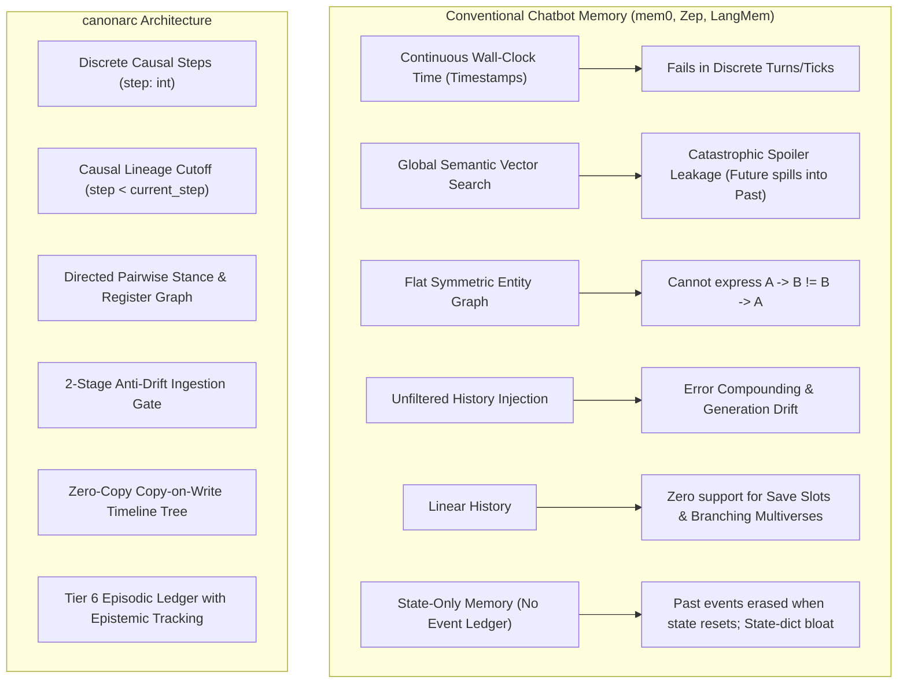

# `canonarc`: Comprehensive Tutorial & Architectural Study Book

> **A deep dive into the design philosophy, mathematical foundations, causal time-travel mechanics, empirical voice anchoring, and episodic event ledger of stateful narrative intelligence.**

---

## Table of Contents
1. [Book Prologue: The Problem Space & The Motivation](#chapter-0-the-problem-space--the-motivation)
2. [Chapter 1: The Core Ontological Model (The 6-Tier Superset)](#chapter-1-the-core-ontological-model-the-6-tier-superset)
3. [Chapter 2: The Storage Engine & The Recursive Lineage CTE](#chapter-2-the-storage-engine--the-recursive-lineage-cte)
4. [Chapter 3: Causal Time Travel, Branching & Counterfactuals](#chapter-3-causal-time-travel-branching--counterfactuals)
5. [Chapter 4: The Voice Bank, Anti-Drift Gates & Stylistic Retrieval](#chapter-4-the-voice-bank-anti-drift-gates--stylistic-retrieval)
6. [Chapter 5: Tier 6 Episodic Event Ledger, Causal Provenance & Epistemic Visibility](#chapter-5-tier-6-episodic-event-ledger-causal-provenance--epistemic-visibility)
7. [Chapter 6: Context Retrieval & Domain Presets](#chapter-6-context-retrieval--domain-presets)
8. [Chapter 7: End-to-End Walkthrough: The Arthur & Merlin Case Study](#chapter-7-end-to-end-walkthrough-the-arthur--merlin-case-study)
9. [Chapter 8: Summary & Architectural Reference Sheet](#chapter-8-summary--architectural-reference-sheet)

---

## Chapter 0: The Problem Space & The Motivation

### 0.1 Why Existing LLM Memory Frameworks Fail in Narratives
In the modern LLM landscape, memory frameworks such as `mem0`, `zep`, and `langmem` are ubiquitous. However, they were built almost exclusively for **conversational support chatbots and customer assistants**. 

When engineers attempt to apply conversational memory engines to **Interactive Fiction (IF), Visual Novels (Ren'Py / Ink), Sequential Game Localization, Multi-Agent Social Simulations, or Creative Co-Pilots**, the system quickly breaks down due to six fatal architectural misalignments:



#### 1. Discrete Causal Time vs. Continuous Wall-Clock Time
* **Chatbots:** Operate on timestamps (`2026-11-12T08:30:00Z`).
* **Narratives:** Operate on **causal steps, scenes, chunks, or ticks** (`step: int`). Step 85 happens strictly after Step 84, regardless of whether the player took 5 seconds or 3 weeks between choices.

#### 2. The Semantic Spoiler Trap (Temporal Incoherence)
Standard RAG indexes all chunks into a vector database. If a user in Chapter 2 asks, *"Why is the old advisor so suspicious?"*, a semantic similarity query over the whole corpus can match an event from Chapter 15 where the advisor is revealed to be a demon spy. Injecting this into Chapter 2 causes the LLM to hallucinate future knowledge, destroying dramatic tension and narrative causality.

#### 3. The Flat Entity Fallacy & Asymmetric Stance
Chatbots treat relationships as symmetric or undirected: *"Arthur and Merlin know each other"*. In drama and literature, relationships are **directed and asymmetric**:
* **Arthur $\to$ Merlin**: Furious, informal register (`"ti"`), distrustful.
* **Merlin $\to$ Arthur**: Calm, polite/formal register (`"Vi"`), paternal.

#### 4. The Self-Conditioning / Generation Drift Loop
When past model-generated text is naively retrieved as few-shot exemplars, a phenomenon known as **Error Compounding** occurs:
1. In Scene 3, the LLM produces a generic, cliché, or grammatically flat dialogue line.
2. In Scene 7, standard vector retrieval pulls that generic line as an exemplar of the character's voice.
3. The LLM mimics this mediocre sample, reinforcing the flaw. By Scene 20, the distinct personality of the character has collapsed into homogenous LLM prose.

#### 5. Branching Multiverses & Zero-Latency Rollback
In visual novels, games, and simulations:
* Players frequently **rewind** (mouse-wheel scrollback) to reread or pick another dialogue branch.
* Timelines **fork** into alternate routes (*"Betray the King"* vs. *"Stay Loyal"*).
* Spawning a heavy graph database (Neo4j), vector database (Pinecone/Qdrant), and document store (Mongo) just to support a desktop game save file is unviable.

#### 6. The State-Only Markovian Trap (Missing Episodic Memory)
When a character's mood returns to `"calm"` at Step 90, the fact that an argument took place at Step 82 disappears from active state unless stuffed into an ever-growing JSON dictionary. Without a dedicated episodic event tier:
* The LLM forgets why relationships changed.
* Developers bloat entity state dicts with historical notes.
* Characters metagame by knowing events they never witnessed.

### 0.2 The Guiding Principles of `canonarc`
`canonarc` was designed around four non-negotiable principles:
1. **Single-File Zero-Ops Portability:** The entire multiverse, graph revisions, episodic events, and vector embeddings reside in a single standard SQLite file (`story.sqlite` or `:memory:`).
2. **Causal Lineage Boundary:** No query can ever see records with $\text{step} \ge \text{current\_step}$ unless explicitly requested.
3. **Strict Linguistic & Voice Gating:** Stylistic memory must be filtered by deterministic lexical quality gates and hard grammatical constraints before vector similarity is even considered.
4. **Epistemic & Causal Grounding:** Events are first-class immutable records with explicit participant roles, epistemic witness filters, and causal provenance links to graph mutations.

---

## Chapter 1: The Core Ontological Model (The 6-Tier Superset)

The library formalizes world state as a **6-Tier Architectural Superset** defined in [`src/canonarc/models.py`](../src/canonarc/models.py).

```
┌─────────────────────────────────────────────────────────────┐
│ Tier 6: Episodic Event Ledger (Causal & Epistemic History)  │
├─────────────────────────────────────────────────────────────┤
│ Tier 5: Gated Voice Bank (Empirical Style & Syntax Anchors) │
├─────────────────────────────────────────────────────────────┤
│ Tier 4: Temporal Versioning & 1-Hop Alias Coreference       │
├─────────────────────────────────────────────────────────────┤
│ Tier 3: Rolling State Deltas & Windowed Trajectories        │
├─────────────────────────────────────────────────────────────┤
│ Tier 2: Pairwise Stance & Register (Asymmetric A -> B)      │
├─────────────────────────────────────────────────────────────┤
│ Tier 1: Base Entity Attributes (Immutable Archetypes/Rules) │
└─────────────────────────────────────────────────────────────┘
```

### Tier 1: Base Entity Attributes (Static Ground Truth)
Entities represent characters, factions, artifacts, or locations. Tier 1 attributes are established at the start of a narrative (`step = 0`) and represent baseline facts:
* Grammatical declension class, grammatical gender.
* Target exonyms / localized names (e.g., Arthur $\to$ `"Artur"`).
* Archetypes and persistent physical traits.

In code (`EntityRecord` in `models.py`):
```python
EntityRecord(
    entity_id="char_arthur",
    canonical_name="Arthur",
    base_attributes={"target_name": "Artur", "gender": "M", "declension": "type_1"},
    state={"mood": "calm"}
)
```

### Tier 2: Pairwise Stance & Grammatical Register ($A \to B$)
Relationships are directed edges keyed by `source_id:relation_type->target_id`. They track:
* **Interpersonal Tone:** Calm, hostile, affectionate, suspicious.
* **Grammatical Register:** Formal vs. informal (T-V distinction: French *tu/vous*, German *du/Sie*, Serbo-Croatian *ti/Vi*, Japanese honorifics *keigo/tameguchi*).
* **Affinity / Trust Score:** Numerical values (e.g., `-1.0` to `+1.0`).

### Tier 3: Rolling State Deltas & Windowed Trajectories
When scenes produce mutations, `apply_delta()` applies Resolve-on-Write materialization. Furthermore, window functions attach `prior_state`, `prior_step`, and `revision_count` to active records. When Arthur's mood cools to `"calm"` at Step 90, the prompt knows he was `"furious"` at Step 82.

### Tier 4: Temporal Versioning & 1-Hop Coreference Expansion
Tier 4 resolves epithets and titles (`"the old wizard"` $\to$ `char_merlin`) and cleanly separates co-present scene entities (`ctx.entities`, `ctx.active_edges`—resolved from text, explicit mentions, or active `location_id`) from 1-hop off-screen social graph neighbors (`ctx.related_entities`, `ctx.background_edges`).

### Tier 5: Gated Dynamic Voice Bank
Vetted dialogue exemplars filtered by hard grammatical register and cosine similarity anchor character style.

### Tier 6: Episodic Event Ledger
Stores immutable N-ary narrative events with semantic roles, optional narrative coordinates (`story_time`, `chapter_id`, `scene_id`), causal provenance pointers (`caused_by_episode_id`), and epistemic visibility tags (`"direct"`, `"told"`, `"deceived"`, `"forgotten"`, `"suppressed"`).

---

## Chapter 2: The Storage Engine & The Recursive Lineage CTE

[`src/canonarc/store.py`](../src/canonarc/store.py) implements the narrative multiverse in a lean, self-contained SQLite schema.

### 2.1 The Schema
The database tracks:
1. `timelines`: DAG of branching timelines (`parent_id`, `fork_step`).
2. `graph_revisions`: Append-only materialized snapshots of entities, typed edges, and aliases.
3. `voice_exemplars`: Historical dialogue exemplars with vector embeddings (`PRIMARY KEY (timeline_id, exemplar_id)`).
4. `episodes`: Discrete plot episodes with semantic participant maps, locations, salience, and embeddings (`PRIMARY KEY (timeline_id, episode_id)`).
5. `episode_epistemics`: Join table recording who knows which episode (`"direct"`, `"told"`, `"deceived"`, `"forgotten"`, `"suppressed"`).
6. `episodes_fts`: SQLite FTS5 virtual table (with sync triggers) for bounded candidate pre-filtering.
7. `store_metadata`: Key-value table tracking `embedder_id` and `embedding_dim` provenance.

### 2.2 The Lineage Resolution CTE: Point-in-Time Resolution with Windowed Trajectory
```sql
WITH RECURSIVE lineage(timeline_id, parent_id, max_step, depth) AS (
    SELECT timeline_id, parent_id, :cutoff_step, 0
    FROM timelines
    WHERE timeline_id = :timeline_id
    UNION ALL
    SELECT
        t.timeline_id,
        t.parent_id,
        CASE
            WHEN l.max_step IS NULL THEN t_child.fork_step
            WHEN t_child.fork_step IS NULL THEN l.max_step
            ELSE MIN(l.max_step, t_child.fork_step)
        END,
        l.depth + 1
    FROM lineage l
    JOIN timelines t_child ON t_child.timeline_id = l.timeline_id
    JOIN timelines t       ON t.timeline_id = l.parent_id
    WHERE l.parent_id IS NOT NULL
),
step_deduped AS (
    SELECT
        r.*,
        l.depth,
        ROW_NUMBER() OVER (
            PARTITION BY r.record_type, r.subject_key, r.step
            ORDER BY l.depth ASC, r.revision_id DESC
        ) AS step_rn
    FROM graph_revisions r
    JOIN lineage l
      ON r.timeline_id = l.timeline_id
     AND (l.max_step IS NULL OR r.step <= l.max_step)
),
ranked_revisions AS (
    SELECT
        revision_id,
        timeline_id,
        step AS valid_from_step,
        record_type,
        subject_key,
        relation_type,
        source_id,
        target_id,
        is_tombstone,
        payload,
        ROW_NUMBER() OVER (
            PARTITION BY record_type, subject_key
            ORDER BY depth ASC, step DESC, revision_id DESC
        ) AS rn,
        COUNT(*) OVER (
            PARTITION BY record_type, subject_key
        ) AS revision_count,
        LEAD(payload) OVER (
            PARTITION BY record_type, subject_key
            ORDER BY depth ASC, step DESC, revision_id DESC
        ) AS prior_payload,
        LEAD(step) OVER (
            PARTITION BY record_type, subject_key
            ORDER BY depth ASC, step DESC, revision_id DESC
        ) AS prior_step,
        LEAD(is_tombstone) OVER (
            PARTITION BY record_type, subject_key
            ORDER BY depth ASC, step DESC, revision_id DESC
        ) AS prior_is_tombstone
    FROM step_deduped
    WHERE step_rn = 1
)
SELECT record_type, subject_key, relation_type, source_id, target_id, valid_from_step,
       payload, revision_count, prior_payload, prior_step, prior_is_tombstone
FROM ranked_revisions
WHERE rn = 1 AND is_tombstone = 0;
```

---

## Chapter 3: Causal Time Travel, Branching & Counterfactuals

Branching (`branch(at_step, name)`) inserts a child timeline row pointing to its parent at `fork_step`.
Rollback (`rollback_to(step)`) deletes records at `step > cutoff` across all tables (raising `TimelineBranchConflictError` if descendant branches forked after `step` unless `force=True`):
```python
engine.rollback_to(step=10, timeline_id="main")
```
You can also prune finished branches with `delete_timeline("route_a", cascade=True)`, isolate concurrent async requests via `with engine.use_timeline("route_a"):` or `engine.session("route_a")`, and record non-linear flashbacks without overwriting present entity state via `StepDelta(is_flashback=True, story_time=...)`.
Counterfactual inspection (`diff_timelines`) and standalone export (`export_snapshot`) work seamlessly across both graph states and episodic events.

---

## Chapter 4: The Voice Bank, Anti-Drift Gates & Stylistic Retrieval

The 2-stage ingestion gate prevents generation drift:
1. **Gate 1:** Regex extraction across quotation styles (`"..."`, `«...»`, `— ...`), word count ($12 \le N \le 60$), Root-TTR distinctiveness, and long-word density (with optional `on_rejected` telemetry callbacks).
2. **Gate 2:** Post-polish quality score ($\ge 8.0$).
3. **Retrieval Cascade:** Strict hard register filtering $\to$ soft tone bonus $\to$ cosine similarity over Weinberger signed-CRC32 n-gram/CJK hash vectors (`canonarc.embedders`), with batch vectorization (`embed_batch()`) and built-in `CallableEmbedder`, `OpenAICompatibleEmbedder`, and `OllamaEmbedder` adapters.

---

## Chapter 5: Tier 6 Episodic Event Ledger, Causal Provenance & Epistemic Visibility

### 5.1 Solving the 6 Episodic Pitfalls

1. **State-Dict Stuffing:** Events are stored in `episodes`, not stuffed into `entity.state`. The entity state remains lean (`{"mood": "calm"}`). Older low-salience events can also be compacted into summary episodes via `consolidate_episodes()`.
2. **Causal Provenance:** Edges and entities link to triggering events via `caused_by_episode_id="ep_82"` and `reason="Sabotaged lance"`. The LLM knows *why* a state exists.
3. **N-Ary Hyperedges:** Events link arbitrary actors, targets, instruments, and locations via semantic role dictionaries (`participants={"char_arthur": "giver", "item_excalibur": "instrument", "char_lancelot": "recipient"}`).
4. **Epistemic Metagaming & Asymmetric Information:**
   - **Episodes:** Characters only recall episodes where they were present (`"direct"`), explicitly informed (`"told"`), or misled (`"deceived"` with a `believed_summary` via `InformDelta`), and can lose access later via `"forgotten"` / `"suppressed"`. For deceived observers, `DefaultEpisodeRanker` embeds `believed_summary` instead of hidden ground-truth `emb_bytes`.
   - **Scoped Disguises & Multi-POV Intersection:** `AliasRecord(kind="disguise", known_to=[...], persona_name="...")` masks true identity, edges, and voice for fooled observers while annotating `(pierced)` for observers in `known_to`. Multi-character scenes support `pov_mode="any"` or shared `pov_mode="all"` across disguises, `belief_state`, `facade`, and provenance.
   - **Private State & Provenance Redaction:** `EntityRecord.private_state` and unwitnessed `reason`/`caused_by_episode_id` fields are automatically redacted for non-POV observers.
   - **Stale Beliefs & Facades:** `relation_type="belief_state"` edges override distant ground-truth changes for ignorant observers, while `relation_type="facade"` edges drive outward voice selection and conceal private `stance` edges.
5. **Trajectory Queries:** `prior_state`, `prior_step`, and `revision_count` let prompts explain that Arthur cooled down from a prior argument. Structured queries (`query_episodes`) allow calculating betrayal frequencies and timelines.
6. **Cue-Based Plot Recall:** `DefaultEpisodeRanker` (configurable via `EpisodicScoringPolicy`) blends POV access, causal pinning, entity/location overlap, semantic similarity, and salience-modulated recency decay ($e^{-\lambda \cdot \Delta\text{step}}$).

---

## Chapter 6: Context Retrieval & Domain Presets

The engine resolves context and renders markdown prompts via:
- `InteractiveFictionPreset`: State transitions, interpersonal stances, relevant episodes, and voice anchors.
- `TranslationPreset`: Declension/gender bindings, register constraints, and narrative episode context.
- `SimulationPreset`: Multi-agent tick perceptions, affinity edges, and collective memories.

---

## Chapter 7: End-to-End Walkthrough: The Arthur & Merlin Case Study

See [`tests/test_episodic_memory.py`](../tests/test_episodic_memory.py) for the complete executable implementation:
1. Arthur arguments with Merlin at Step 82 $\implies$ episode `ep_arg_82` recorded, mood `"furious"`.
2. Arthur cools to `"calm"` at Step 90 $\implies$ state resets cleanly to `{"mood": "calm"}`.
3. Query at Step 95 $\implies$ `StepContext` contains clean state, windowed trajectory `(was: furious at step 82)`, and recalls `ep_arg_82` in episodic memory.

---

## Chapter 8: Summary & Architectural Reference Sheet

### Component Mapping

| Subsystem | Primary Code File | Key Classes & Functions | Responsibility |
| :--- | :--- | :--- | :--- |
| **Data Models** | [`src/canonarc/models.py`](../src/canonarc/models.py) | `EntityRecord`, `DirectedEdgeRecord`, `EpisodeRecord`, `InformDelta`, `VoiceExemplar`, `StepDelta`, `ResolvedMention` | Pydantic v2 schemas modeling Tiers 1–6 & `EpistemicMode` |
| **Storage & Causal Graph** | [`src/canonarc/store.py`](../src/canonarc/store.py) | `MemoryStore`, `CausalStore`, Recursive CTE | SQLite storage (`timelines`, `graph_revisions`, `voice_exemplars`, `episodes`, `episode_epistemics`, `episodes_fts`, `store_metadata`), lineage traversal, snapshots, timeline deletions, atomic rollbacks |
| **Embedders** | [`src/canonarc/embedders.py`](../src/canonarc/embedders.py) | `Embedder`, `OfflineNgramEmbedder`, `CallableEmbedder`, `OpenAICompatibleEmbedder`, `OllamaEmbedder` | Pluggable vectorizers with CJK tokenization, signed CRC32 hashing, and batching |
| **Voice Bank & Gates** | [`src/canonarc/voice.py`](../src/canonarc/voice.py) | `VoiceBank`, `IngestionGate` | Multi-alphabet regex extraction, Root-TTR gate, hard-register cascade |
| **Episodic Ranker** | [`src/canonarc/episodic.py`](../src/canonarc/episodic.py) | `EpisodeRanker`, `DefaultEpisodeRanker`, `EpisodicScoringPolicy` | Deceived-POV safe hybrid 4-signal Tier 6 scorer |
| **Mention Resolver** | [`src/canonarc/resolver.py`](../src/canonarc/resolver.py) | `MentionResolver`, `DefaultLexicalResolver` | Word-boundary, shared alias span, and fuzzy inflection resolution |
| **LLM Extractors** | [`src/canonarc/extractors.py`](../src/canonarc/extractors.py) | `DeltaExtractor`, `CallableExtractor`, `OpenAICompatibleExtractor` | JSON-fence stripping and Pydantic validation retry loop for `StepDelta` |
| **Lifecycle Hooks** | [`src/canonarc/hooks.py`](../src/canonarc/hooks.py) | `EngineHooks`, `BaseEngineHooks` | Observability callbacks for commit, rollback, branch, and gate rejections |
| **Domain Presets** | [`src/canonarc/presets.py`](../src/canonarc/presets.py) | `SchemaPolicy`, `InteractiveFictionPreset`, `TranslationPreset`, `SimulationPreset` | Prompt engineering templates for game engines, translation, and simulations |
| **Engine Facade** | [`src/canonarc/engine.py`](../src/canonarc/engine.py) | `CanonArcEngine`, `StepTransaction`, `TimelineSession` | High-level API, POV projection, consolidation, `contextvars` sessions, transactions |
| **CLI Inspector** | [`src/canonarc/cli.py`](../src/canonarc/cli.py) | `canonarc tree / inspect / diff / history` | Terminal inspection of `.sqlite` timelines, state, diffs, and revisions |

### Key API & CLI Cheatsheet

```python
# Initialization & Concurrency-Safe Sessions
with CanonArcEngine("save.sqlite") as engine:
    # Transactional Game Loop (Auto-rollback on error)
    with engine.step_transaction(step=current_step, text=scene_text, top_k_episodes=5) as tx:
        ctx = tx.context
        prompt = engine.format_context(ctx)
        response = call_llm(prompt)
        tx.commit(
            delta=extracted_delta,
            exemplars=extracted_lines,
            episodes=extracted_episodes,
        )

    # Branching, Session Isolation, Pruning & Rollback
    engine.branch(at_step=20, name="alternate_route", switch=True)
    with engine.use_timeline("alternate_route"):
        ...
    engine.rollback_to(step=10, timeline_id="main")
    engine.delete_timeline("alternate_route", cascade=True)

    # Episodic Querying, Epistemic Updates & Compaction
    episodes = engine.query_episodes(
        participants=["char_arthur", "char_merlin"],
        predicate="argument",
    )
    engine.inform_entity(step=60, episode_id="ep_secret_betrayal", entity_id="char_guinevere")
    engine.consolidate_episodes(step=100, before_step=50, summary="Act I summary")
```

```bash
canonarc tree save.sqlite
canonarc inspect save.sqlite --timeline main --step 85 --pov char_arthur
canonarc diff save.sqlite main alternate_route --step 85
canonarc history save.sqlite char_arthur --timeline main
```
